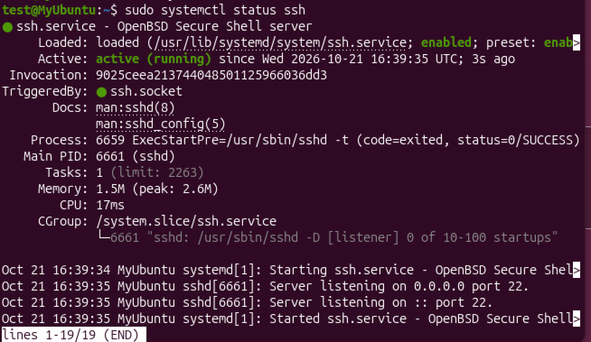
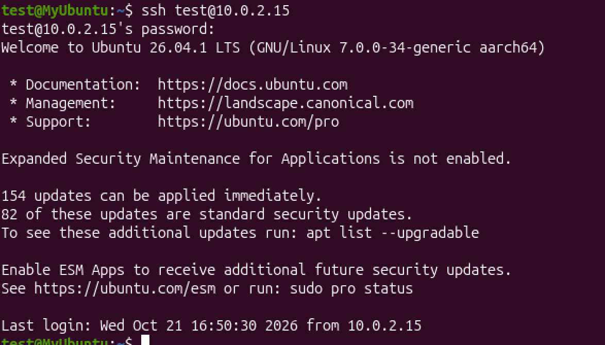
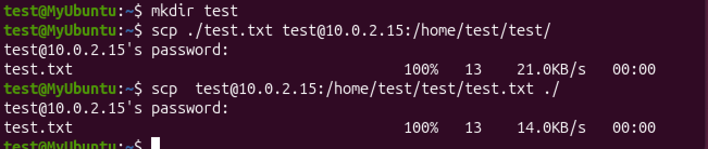
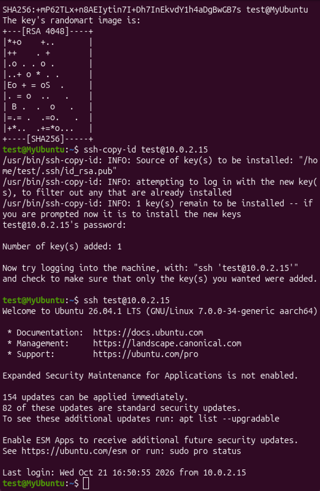

# Установка и настройка SSH-сервера

## Кейс 1. Установка SSH-сервера

Данное руководство поможет вам установить SSH-сервер на виртуальную машину, настроить его базовые параметры и проверить корректность работы.

### Шаг 1. Обновление индексов пакетов

Перед установкой нового ПО рекомендуется обновить списки пакетов в системе, чтобы установить актуальную версию.

```bash
sudo apt update
```

### Шаг 2. Установка SSH-сервера

Установите пакет `openssh-server` с помощью пакетного менеджера `apt`:

```bash
sudo apt install -y openssh-server
```

### Шаг 3. Запуск и настройка автозапуска службы

Убедитесь, что служба SSH добавлена в автозапуск (будет стартовать автоматически при включении виртуальной машины) и запущена:

```bash
# Добавление в автозапуск
sudo systemctl enable ssh

# Запуск службы
sudo systemctl start ssh
```

## Шаг 4. Проверка статуса службы

Для проверки текущего состояния SSH-сервера выполните команду:

```bash
sudo systemctl status ssh
```

### Ожидаемый результат:



---

## Кейс 2. Подключение к удаленному серверу

### Шаг 1. Подготовка данных для подключения

Для успешного подключения вам понадобятся:
1. **IP-адрес** удаленного сервера (например, `10.0.2.15`).
2. **Имя пользователя** (логин) на удаленном сервере (например, `test`).
3. **Пароль** от этой учетной записи.

### Шаг 2. Выполнение команды подключения

Откройте терминал на вашем локальном компьютере и введите команду `ssh`, указав имя пользователя и IP-адрес через символ `@`:

```bash
ssh test@10.0.2.15
```

> **Примечание:** Если ваш SSH-сервер настроен на нестандартный порт (отличный от 22), добавьте ключ `-p` и номер порта, например: `ssh -p 2222 test@10.0.2.15`.

### Шаг 3. Первое подключение и проверка ключа 

Если вы подключаетесь к этому серверу **впервые**, терминал выдаст предупреждение безопасности о подлинности хоста:

```text
The authenticity of host '192.168.1.100 (192.168.1.100)' can't be established.
ED25519 key fingerprint is SHA256:7mX...
Are you sure you want to continue connecting (yes/no/[fingerprint])?
```

1. Введите **`yes`** и нажмите **Enter**.
2. Сервер добавит IP-адрес в список известных хостов (`~/.ssh/known_hosts`). При повторных подключениях этот вопрос появляться не будет.

### Шаг 4. Ввод пароля

После подтверждения ключа система запросит пароль:

```text
user@192.168.1.100's password:
```

Введите пароль от удаленного сервера и нажмите **Enter**.


---

### Ожидаемый результат



## Кейс 3: Копирование файлов с помощью SCP

### Подготовка: Создание целевой папки

Перед началом копирования можно создать целевую папку на локальной или удаленной машине (если её еще нет) с помощью команды `mkdir` и файл text.txt:

```bash
# Создаем папку test
mkdir test

# Переходим в созданную папку
cd test

# Создаем файл test.txt с текстом 1234 внутри
echo "1234" > test.txt

# Создаем еще одну папку test
mkdir test

```

### Шаг 1. Передача файла с локальной машины на удаленный сервер

Чтобы скопировать файл `test.txt` из текущей локальной папки в директорию `/home/test/test/` на удаленном сервере с IP-адресом `10.0.2.15`, выполните:

```bash
scp ./test.txt test@10.0.2.15:/home/test/test/
```

#### Ход выполнения:
1. Система запросит пароль: `test@10.0.2.15's password:`.
2. Введите пароль пользователя `test` и нажмите **Enter**.
3. В терминале отобразится статус загрузки, размер (13 байт) и успешное завершение:
   ```text
   test.txt                                     100%   13     21.0KB/s   00:00
   ```

### Шаг 2. Копирование файла с удаленного сервера на локальную машину

Чтобы скачать этот же файл `test.txt` обратно с сервера в текущую локальную папку (`./`), поменяйте аргументы местами и выполните команду:

```bash
scp test@10.0.2.15:/home/test/test/test.txt ./
```

#### Ход выполнения:
1. Система снова попросит подтвердить операцию вводом пароля.
2. После ввода пароля начнется скачивание файла:
   ```text
   test.txt                                     100%   13     14.0KB/s   00:00
   ```

---

### Ожидаемый результат



## Кейс 4: Работа с ключами SSH

### Шаг 1. Генерация пары SSH-ключей

Откройте терминал на вашей **локальной** машине и выполните команду `ssh-keygen` для генерации пары ключей (приватного и публичного):

```bash
ssh-keygen -t ed25519
```

> **Примечание:** Флаг `-t ed25519` указывает современный, быстрый и наиболее безопасный тип алгоритма шифрования. Если ваша система его не поддерживает, можно использовать `ssh-keygen -t rsa -b 4096`.

#### Процесс генерации в терминале:
1. Система спросит, куда сохранить ключ (`Enter file in which to save the key...`). Просто нажмите **Enter**, чтобы оставить путь по умолчанию (`~/.ssh/id_ed25519`).
2. Далее система предложит ввести кодовую фразу для защиты ключа (`Enter passphrase...`). Для полностью автоматического беспарольного входа нажмите **Enter** дважды (оставив поле пустым).

### Шаг 2. Копирование публичного ключа на удаленный сервер

Чтобы удаленный сервер узнавал ваш компьютер, необходимо скопировать на него ваш **публичный (открытый)** ключ. Для этого используется утилита `ssh-copy-id`.

Выполните команду на **локальной** машине (замените данные пользователя и IP на свои):

```bash
ssh-copy-id test@10.0.2.15
```

#### Ход выполнения:
1. Утилита подключится к серверу и в последний раз попросит ввести **пароль** от учетной записи `test`.
2. После успешного ввода пароля ваш публичный ключ автоматически запишется в специальный файл `~/.ssh/authorized_keys` на удаленном сервере.
3. В терминале появится сообщение: `Number of key(s) added: 1`.

### Шаг 3. Подключение к серверу с использованием SSH-ключа

Теперь проверьте работу беспарольного режима. Выполните стандартную команду подключения со своей **локальной** машины:

```bash
ssh test@10.0.2.15
```

---

### Ожидаемый результат

